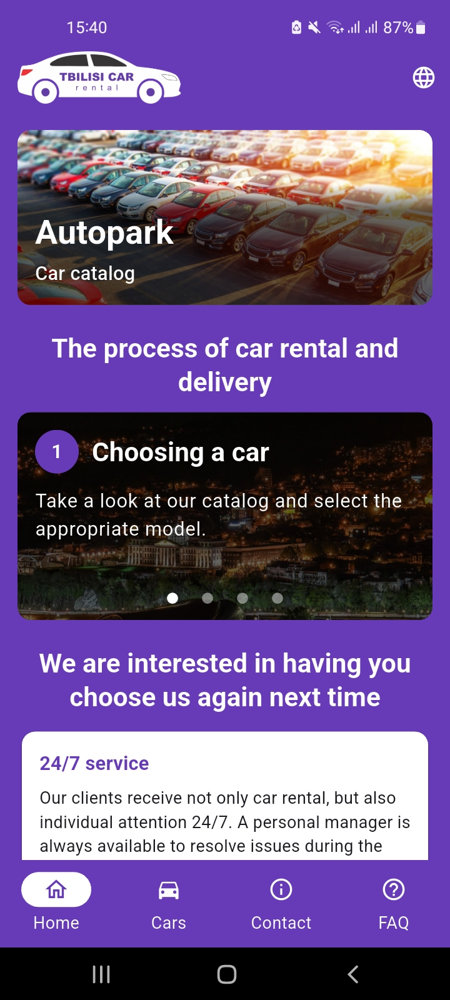
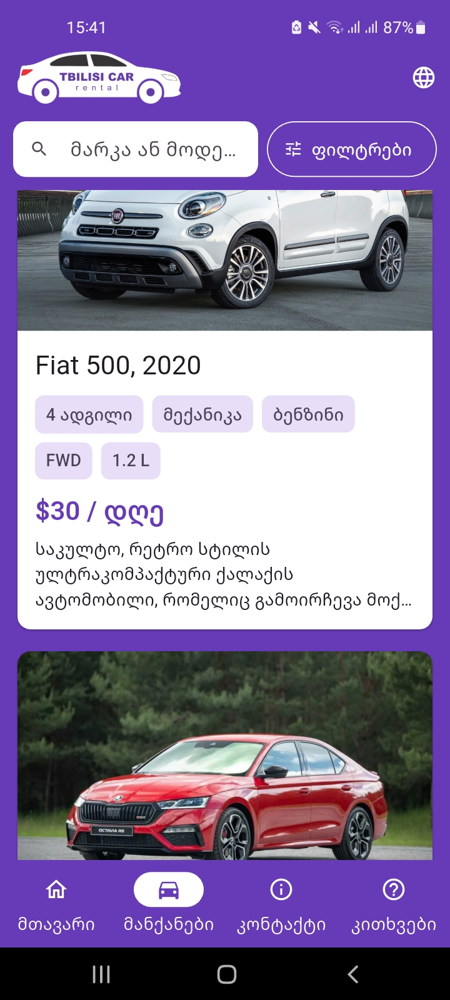
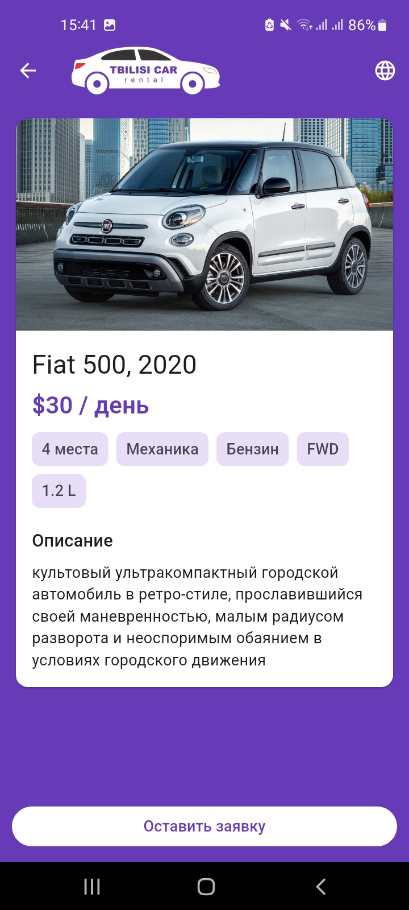
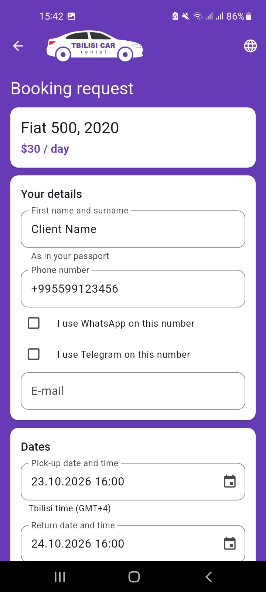
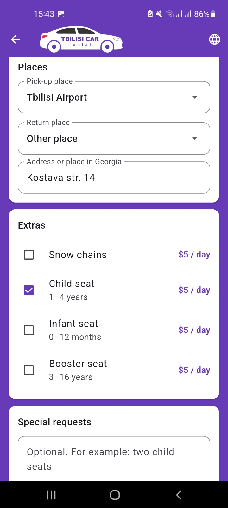
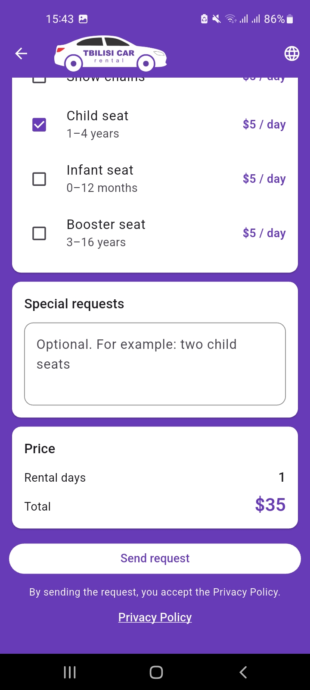
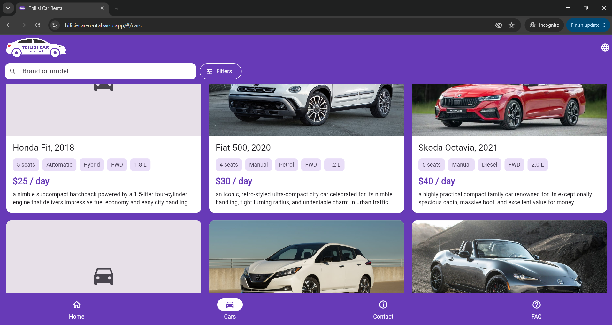
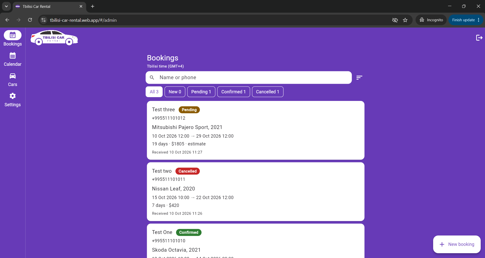
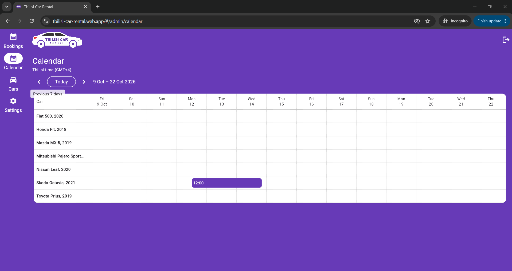

# Tbilisi Car Rental

A car-rental app for a company in Tbilisi that does not exist. I built it
as a portfolio project: a public app where people look at cars and send a
booking request, and an admin panel where those requests are handled.

- Web app: https://tbilisi-car-rental.web.app
- Android app: [release v1.0.0](https://github.com/LukaMeletidi/tbilisi-car-rental/releases/tag/v1.0.0).
  Download the APK on an Android phone and open it. Android will ask
  before installing, because the app does not come from Google Play.

## What it does

Visitors get a home page, a catalog of cars with search and filters, a
page for each car, and a booking form that shows the number of rental
days and an estimated total before anything is sent. There is also an
FAQ, a contact page and a privacy page. The app speaks Georgian, Russian
and English, and it was made for phones first.

The other half is the admin panel. There the company goes through the
booking requests and moves them through their statuses, sees on a
calendar which car is out when, and edits the cars, the prices of the
extras and its own contact details. It is meant for a computer's browser
and is not open to visitors, so the screenshots below are the only way to
see it.

## Screenshots

<table>
  <tr>
    <td></td>
    <td></td>
    <td></td>
    <td></td>
    <td></td>
    <td></td>
  </tr>
  <tr>
    <td>Home</td>
    <td>Catalog</td>
    <td>A car</td>
    <td>Booking request</td>
    <td>Extras</td>
    <td>Price estimate</td>
  </tr>
</table>

The website in a wide browser window:



The admin panel, with made-up test bookings:





## How it is built

The app is written in Flutter and Dart, with Riverpod for state and
go_router for navigation. The same code runs as the website and as the
Android app. Behind it is Firebase on the free plan: Firestore for the
data, Authentication for the one admin account, Hosting for the website,
and App Check, which for now only watches the requests. There is no
server code of my own.

A few rules carry most of the logic. A rental is counted in 24-hour days,
with two hours of grace and at least one day, and the total is worked out
in whole cents. Times are stored in UTC and always shown in Tbilisi time,
whatever the time zone of the device. When the admin confirms a booking
that comes within five hours of another confirmed booking for the same
car, the app warns but never blocks. The admin is recognised by a flag on
the account in Firebase, so no address or user id of the admin is in the
code.

The security sits in the Firestore rules, not in the app: anyone can read
the active cars and send a booking request, and only the admin can read
or change bookings. I checked the rules against the local Firestore
emulator. There are 2,536 Flutter tests and 114 tests for the project's
own scripts. Before every commit a script scans the changes for secrets
and personal data. Before the release, another script checked that the
APK holds no secret, and before this repository went public I checked
every file in its whole history the same way.

## How I worked

I designed the app and made the decisions: what it should do, how the
data is organised, the business rules, and who may see or change what.
The code was written by Claude Code, an AI coding assistant, under my
direction. We went in small steps. For each one I asked for a plan first,
approved or changed it, and then checked the result myself on the Android
emulator, in the browser or on my phone before anything was committed.

Every step, decision and check is in my working notes,
[docs/PLAN.md](docs/PLAN.md). The mistakes are in there too, along with
how they were found and fixed.

## What is not done

The company, the cars and the prices are made up, and nobody answers a
booking request. I could not build or test an iOS version, because I work
on Windows. I did not test the app with TalkBack. On the web, reloading
the page without a connection cannot work, because the site keeps no
offline copy. App Check only watches and enforces nothing, and the admin
panel is not open to visitors.

Next I would polish the texts of the admin panel and test the app with
TalkBack and on an iPhone.

## Running it yourself

The app in this repository points to my Firebase project, so you need
your own:

1. Create a Firebase project with Firestore and e-mail/password sign-in,
   and run `flutterfire configure`. It replaces
   `lib/firebase_options.dart`, `android/app/google-services.json` and the
   project settings in `firebase.json`; set your project in `.firebaserc`
   too. On the web, App Check uses my reCAPTCHA key: set
   `appCheckWebSiteKey` in `lib/core/config/app_check_config.dart` to your
   own key, or to an empty string to turn App Check off there.
2. Deploy the rules and indexes:
   `firebase deploy --only firestore --project <your-project>`.
3. Create the admin account in Authentication and give it the admin flag
   with `tool/admin/set_admin_claim.mjs` (run `npm install` in
   `tool/admin` first). It needs a service-account key, which must stay
   outside the repository.
4. Run the app with `flutter run`, or `flutter run -d chrome` for the
   website, sign in to the admin panel and add the cars.

The tests need no Firebase project: `flutter test` and
`node --test tool/*.test.mjs`. The rules checks need the Firestore
emulator and Java, in one command:

```
firebase emulators:exec --only firestore --project demo-tbilisi-car-rental "node tool/check_booking_rules.mjs"
```

The APK in the release is signed with my own key, which is not in this
repository; a release build of your own needs your own keystore and an
`android/key.properties`, both ignored by git. My data is not in the
repository either.

## Licence

There is no licence for now, so all rights are reserved.

Author: [LukaMeletidi](https://github.com/LukaMeletidi) on GitHub.
